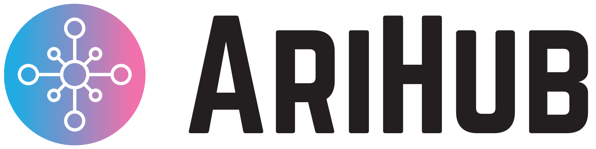

<a href="https://www.arihub.com/">
<picture>
<source media="(prefers-color-scheme: dark)" srcset="assets/arihub-logo-dark.svg">

</picture>
</a>

# Welcome to AriHub 👋

[AriHub](https://www.arihub.com/) is a Norwegian startup making WordPress plugins for the rules websites now have to follow: **cookie consent**, **accessibility** and **e-invoicing**. Every plugin has a free version that works on its own, and a Pro version for businesses that need more.

We are honest about what our plugins do and do not do, and our plugins never send your visitors' data to us.

## Our plugins

| Plugin | What it does | Status |
|---|---|---|
| [**AriConsent**](https://www.arihub.com/ariconsent/) | A fair cookie banner where “Reject all” is as easy as “Accept all”. Blocks trackers until visitors agree, sends Google Consent Mode v2 signals and keeps an anonymous consent log. | Free. Coming to WordPress.org. Pro planned. |
| [**AriTOC**](https://www.arihub.com/aritoc/) | A fast, accessible table of contents. Automatic, block, shortcode or widget, and it works on block themes and paginated posts. | Free. Coming to WordPress.org. AriTOC Pro add-on. |
| [**AriLinks**](https://www.arihub.com/arilinks/) | Turns keywords into internal links across your site, creates them in bulk from titles and SEO focus keywords, and finds pages nothing links to. | Free. Coming to WordPress.org. |
| [**AriRelated**](https://www.arihub.com/arirelated/) | Related posts that are really about the same topic, inline “Read also” links, and click stats without cookies. | Free. Coming to WordPress.org. |
| [**AriAccess**](https://www.arihub.com/ariaccess/) | Finds and fixes real accessibility problems, with every issue mapped to WCAG and to Norway's rules. A display panel for visitors and an accessibility statement. No overlay. | Free. Coming to WordPress.org. Pro planned. |
| [**AriInvoice**](https://www.arihub.com/ariinvoice/) | EHF and Peppol e-invoices from WooCommerce, for Norway's e-invoicing rules from 2027. | Exploring. [Tell us](https://www.arihub.com/ariinvoice/#tell-us) if you need it. |

See the [roadmap](https://www.arihub.com/roadmap/) for what comes next.

## For site owners and agencies

- 🧩 **Free that really works.** The free version is not a trial, and free features never move to Pro.
- 🇳🇴 **Nordic languages.** AriConsent's banner comes in Norwegian Bokmål and Nynorsk, Swedish, Danish and Finnish, alongside English, and arihub.com is in all six.
- 🔒 **Your data stays on your site.** Logs and settings live in your own WordPress database.
- 🤝 **Agencies welcome.** Use the free plugins on every client site, and [tell us](mailto:info@arihub.com?subject=AriHub%20for%20agencies) what your clients need.

## What we build

| Project | What it is | Built with |
|---|---|---|
| **WordPress plugins** | AriConsent, AriTOC, AriLinks, AriRelated and AriAccess. | PHP, JavaScript, WordPress block editor |
| **AriConsent GTM template** | The [Google Tag Manager template](https://github.com/arihub/ariconsent-gtm-template) that connects AriConsent to Consent Mode. | Google Tag Manager sandboxed JavaScript |
| **arihub.com** | Our website in six languages, the blog and the help centre at [arihub.com](https://www.arihub.com/). | HTML, CSS, a WordPress block theme |

Our product repositories are private. The public repositories here are our Tag Manager template and forks of open-source projects we have learned from.

## Our approach

- **Solve the problem first.** Every plugin starts from a real business task, not a feature list.
- **Honest about limits.** Each product page says what the plugin does not do. A plugin alone does not make a site compliant.
- **Privacy by default.** No phoning home, no tracking, and accessible by design (checked against WCAG 2.2 AA).

## Get in touch

- 🌐 [www.arihub.com](https://www.arihub.com/) · 📝 [Blog](https://www.arihub.com/blog/) · 📚 [Help centre](https://www.arihub.com/help/)
- ✉️ [info@arihub.com](mailto:info@arihub.com) · 🛡️ [Report a security issue](https://www.arihub.com/security/)
- Follow us on [Easybie](https://www.easybie.com/@arihub)

Made in Norway by ARIFUR RAHMAN ENK. WordPress is a trademark of the WordPress Foundation. AriHub is not affiliated with it.
